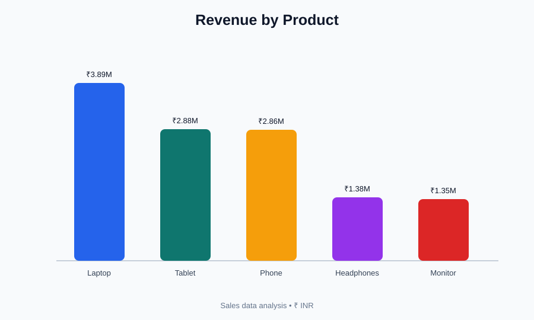
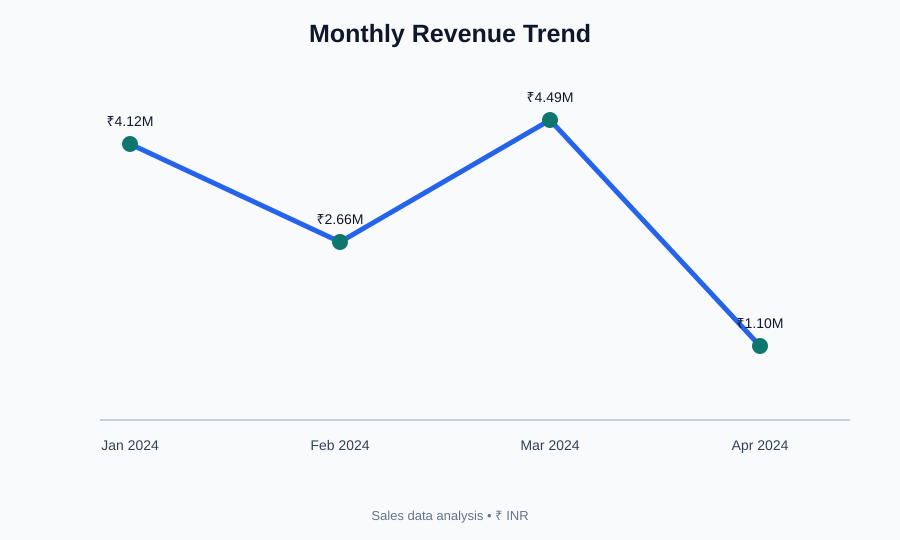
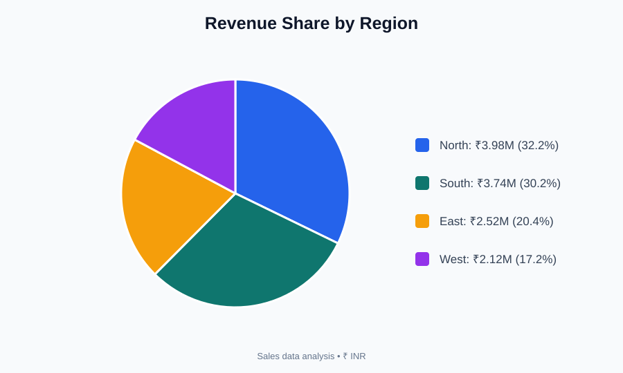

# Sales Data Analysis Report

## Project overview

This project analyzes the supplied e-commerce sales CSV with pandas, cleans and validates its records, calculates useful metrics, and visualizes patterns with bar, line, and pie charts.

## Dataset and cleaning

- 100 sales records and 7 columns; the supplied file contains no missing cells or duplicate rows.
- Date range: 1 January 2024 – 9 April 2024.
- The script checks required fields, removes duplicates and invalid dates/quantities/prices, and recomputes revenue as Quantity × Price.

## Key metrics

- Total revenue: **₹12,365,048.00**
- Units sold: **478**
- Average revenue per record: **₹123,650.48**
- Distinct customers: **100**
- Top product by revenue: **Laptop (₹3,889,210.00)**
- Highest revenue region: **North (₹3,983,635.00)**
- Highest revenue month: **March 2024 (₹4,485,006.00)**

## Visualizations

## Insights

1. Laptop is the largest revenue contributor at ₹3,889,210.
2. March 2024 is the strongest month. April covers only the first nine days, so its total is not directly comparable with full months.
3. North leads regional revenue at ₹3,983,635; South follows at ₹3,737,852.

## How to run

Install dependencies with `python -m pip install -r requirements.txt`, then run `python main.py` from the project folder. The program regenerates three PNG charts and this Markdown report.

## Learning reflection

I practiced reading CSV data with pandas, checking and cleaning records, grouping values for calculations, writing reusable functions, handling errors, and explaining results with three chart types.
